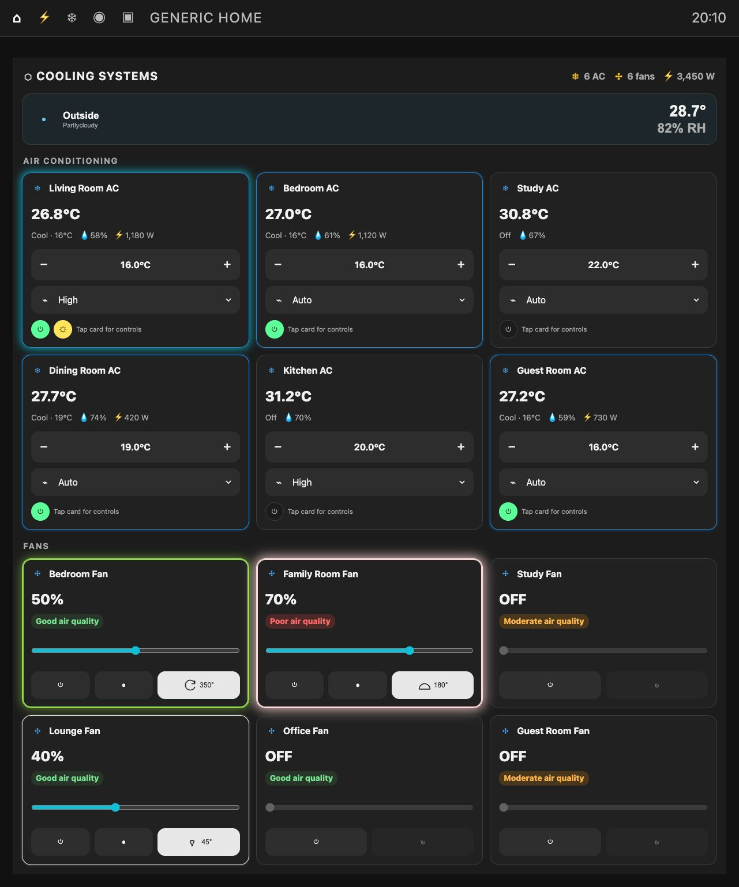
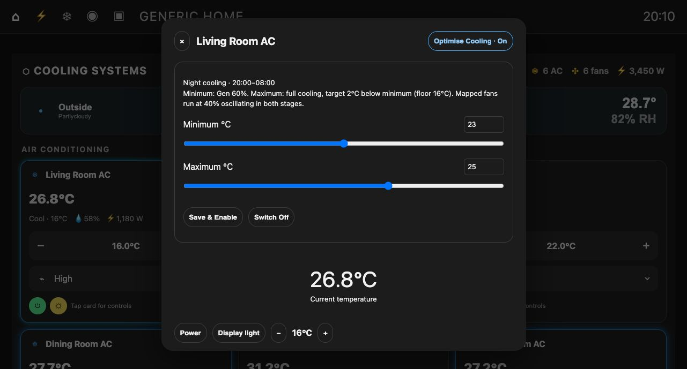
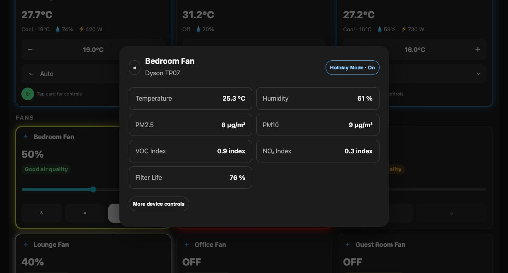

# Cooling Dashboard

A responsive Home Assistant Lovelace card for air conditioners, fans, air quality and weather. It provides a polished whole-home cooling screen while remaining brand-neutral and safe to share.

## Screenshots

Running ACs use a blue pulse, while running fans use a white pulse. A running fan with poor air quality pulses red and white; Holiday Mode pulses green and yellow. Temperature, fan-mode, speed and sweep controls remain expanded on the dashboard.



Tapping a device opens its cooling details. Optional top-right buttons configure night optimisation or Holiday Mode. “More device controls” opens Home Assistant's native dialog.





## Features

- Expanded climate and fan cards in responsive grids
- Current and target temperature
- Optional humidity and live-power sensors
- Total configured cooling power in the header
- Running AC glow and a faster pulse for the coldest running room
- White pulsing fan cards and an animated fan icon while running
- Optional PM2.5 air-quality status: green for good, orange for moderate and red for poor
- Red/white warning pulse when a fan is running during poor air quality
- Expanded temperature, climate fan-mode, fan-speed and oscillation controls
- Fan speed and oscillation stay locked while the fan is off; only its power button starts it
- Optional AC display/LED toggle
- Top-left power icons for both ACs and fans
- Optional adjustable night optimisation with min/max sliders (20:00-08:00 only)
- Optional 4-hours-on / 2-hours-off fan Holiday Mode and Sunday noon reminders
- Optional 45° / 90° / 180° / 350° sweep cycling, matching angle icons and separate Sweep Off
- Fan model and configurable room air-quality readings in opened fan cards
- Optional reusable solar-surplus and battery-guarded daytime cooling blueprints
- Current outside weather
- Tap a device for its cooling details; open native controls from there
- No cloud service, subscription or telemetry

## Install with HACS

1. Open **HACS → ⋮ → Custom repositories**.
2. Add `https://github.com/obaiii/ha-cooling-dashboard` as a **Dashboard** repository.
3. Find **Cooling Dashboard** in HACS and install it.
4. Refresh the browser or fully restart the Home Assistant mobile app.

HACS normally adds the JavaScript resource automatically. If it does not, add this under **Settings → Dashboards → Resources**:

```text
/hacsfiles/ha-cooling-dashboard/cooling-dashboard.js
```

Resource type: **JavaScript Module**.

## Add the card

Create a Manual card and start with:

```yaml
type: custom:cooling-dashboard
title: COOLING SYSTEMS
weather: weather.forecast_home
outside_humidity: sensor.outside_humidity
ac_columns: 3
fan_columns: 3

air_conditioners:
  - entity: climate.living_room
    name: Living Room
    humidity: sensor.living_room_humidity
    power: sensor.living_room_ac_power
    led: switch.living_room_ac_display

  - entity: climate.bedroom
    name: Bedroom
    power_attribute: realtime_power

fans:
  - entity: fan.living_room
    name: Living Room Fan
    humidity: sensor.living_room_fan_humidity
    pm2_5: sensor.living_room_fan_pm_2_5
```

Replace every example entity with an entity from your own Home Assistant. A larger example is in [`examples/dashboard.yaml`](examples/dashboard.yaml).

## Configuration

### Main options

| Option | Required | Description |
|---|---:|---|
| `air_conditioners` | No* | List of climate units |
| `fans` | No* | List of fans |
| `weather` | No | Weather entity |
| `outside_humidity` | No | Separate outside-humidity sensor |
| `title` | No | Header text; defaults to `COOLING SYSTEMS` |
| `ac_columns` | No | Desktop AC columns; defaults to 3 |
| `fan_columns` | No | Desktop fan columns; defaults to 3 |
| `show_summary` | No | Show device counts and total power |

*At least one of `air_conditioners` or `fans` must be supplied.

### Per-device options

| Option | Required | Description |
|---|---:|---|
| `entity` | Yes | `climate.*` or `fan.*` entity |
| `name` | No | Display name |
| `humidity` | No | Humidity sensor |
| `power` | No | Power sensor in watts |
| `power_attribute` | No | Climate/fan attribute containing watts |
| `pm2_5` | No | PM2.5 sensor used for the fan air-quality badge and poor-air warning pulse |
| `led` | No | Optional switch controlling an AC display light |
| `icon` | No | Optional Material Design icon |

If neither `power` nor `power_attribute` is set, the card also checks the common `compressor_power`, `realtime_power`, and `power` attributes.

Air-quality thresholds use PM2.5 values: good is 12 µg/m³ or below, moderate is above 12 through 35 µg/m³, and poor is above 35 µg/m³.

### Optional mode controls

| Per-device option | Description |
|---|---|
| `optimisation` | AC object with `enabled` (input_boolean), `minimum` and `maximum` (input_number) helpers. Shows the top-right Optimise Cooling button and sliders. |
| `optimisation.save_script` | Optional custom script ID; defaults to `cooling_dashboard_save_optimisation`. The provided package contains this script. |
| `holiday_mode` | Fan Holiday Mode input_boolean. Requires the Holiday Mode blueprint to perform the cycle. |
| `sweep` | Fan object enabling angle cycling. Default service is `dyson_local.set_angle`, using `angle_low`/`angle_high` attributes and bounds 5–355°. Only enable for a compatible integration. |
| `model` | Verified fan model, for example `Dyson TP07`. Displayed in the opened fan card. |
| `air_quality` | List of `{entity, name}` sensor objects for all environmental readings you want to display. |

The sweep angle button cycles **45° → 90° → 180° → 350° → 45°**. The separate Off button only stops oscillation. Neither starts a powered-off fan. Standard fans without `sweep` keep their normal oscillation toggle. Holiday Mode enforces its own maximum sweep while running.

## Optional cooling automations

HACS installs **only the dashboard JavaScript**. Mode buttons control helpers; they do not install automations. Follow [the setup guide](docs/automations.md) to add the optional helper package and import blueprints, then select your own devices and sensors.

| Blueprint | Behaviour |
|---|---|
| [Night cooling optimisation](blueprints/night-cooling-optimisation.yaml) | Midea `midea_ac_lan` only. Per-room min/max controls, Gen 60% at minimum and normal/full cooling at maximum; 20:00-08:00. Mapped fans run at 40% oscillating in both stages. |
| [Fan Holiday Mode](blueprints/fan-holiday-mode.yaml) | Four hours at 50% with oscillation, two hours off, repeat until disabled. Toggle and cycle timestamp persist through restarts. Optional Dyson 350° sweep. |
| [Weekly reminder](blueprints/holiday-weekly-reminder.yaml) | Sunday noon reminder naming active Holiday Mode toggles, using your own chosen notification action. |
| [Solar-surplus cooling](blueprints/solar-surplus-cooling.yaml) | Battery 100% plus five minutes of measured spare solar: Cool 16°C, High. Optional automatic shedding after two minutes of shortfall, 15-minute restart cooldown, manual priority. |
| [Daytime schedule](blueprints/kitchen-daytime-schedule.yaml) | Cool 16°C at 09:00 above 35% battery, recovery starts before 17:00, off at 17:00 or below 30%. |

All times use **your HA timezone**. These examples are opt-in; inspect their policies before enabling them. Solar headroom must come from trustworthy power measurements. At full battery, curtailed PV can hide spare capacity, so a measured-headroom gate may wait even in sunshine. Starting at 16°C can demand much more power than maintaining a warmer room; size the startup margin for your equipment.

For priority/flexible solar cooling, use one blueprint instance per AC. Disable `shed` for the priority room that should remain on; enable it for the flexible room. Manual commands and remote setting changes release solar ownership for the day. The daytime schedule has a different policy: its scheduled/battery shutdown still applies to manually started ACs.

## Manual installation

Download `cooling-dashboard.js`, copy it to `/config/www/`, and add this JavaScript module resource:

```text
/local/cooling-dashboard.js
```

## Privacy

The repository contains no Home Assistant tokens, URLs, IP addresses or private household entity IDs. All configured entities remain inside the user's own Home Assistant instance.

## License

MIT
